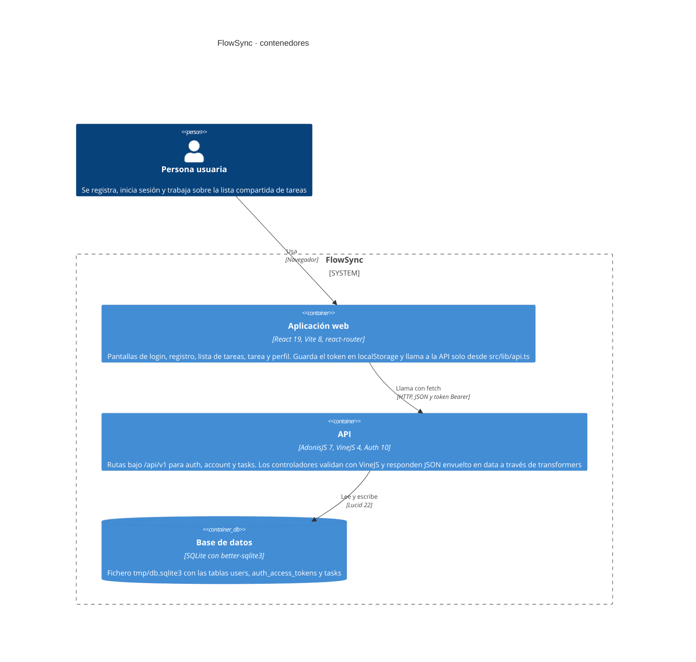

# Arquitectura de FlowSync

Este diagrama muestra los contenedores de FlowSync en el nivel C4: la aplicación web de React que corre en el navegador, la API de AdonisJS a la que llama y la base de datos SQLite en la que la API guarda las cuentas, los tokens de acceso y las tareas. Sale de leer `frontend/src/`, `backend/start/`, `backend/app/`, `backend/config/` y `backend/database/migrations/`. No dibuja ningún entorno de despliegue porque el repositorio no tiene configuración de despliegue: lo que se ve es el montaje local que levanta `make start`. Tampoco aparece el guard de sesión `web`, que está configurado pero no lo usa ninguna ruta: todas las protegidas autentican con access tokens.

